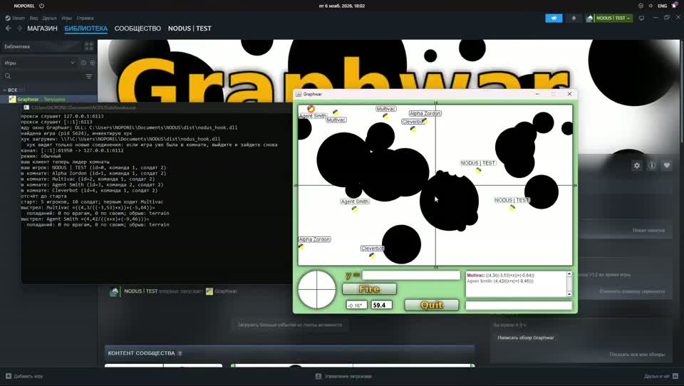

# NODUS

Бот для Graphwar: играет за вашего солдата, считая кривую через врагов и
проверяя её той же физикой, что использует клиент.

Работает как локальный прокси на `127.0.0.1:6113` плюс DLL, которая
перенаправляет соединения игры в этот прокси. Клиент и сервер видят обычное
соединение; бот лишь читает протокол и в нужный момент отправляет выстрел.

## Пример работы

[](showcase/showcase.mp4)

Записано на компьютере разработчика: слева консоль бота, справа клиент
Graphwar. Нажмите на превью, чтобы открыть видео.

## Что делает бот

- Запоминает карту и солдат из `START_GAME`, следит за ходами и попаданиями
  по сообщениям сервера.
- Пока думают соперники, перебирает варианты кривой на всех ядрах.
- На вашем ходу выбирает лучший план, проверяет готовую строку формулы и
  отправляет `FIRE_FUNC` от имени вашего клиента.
- Не двигает солдат, не меняет прицел и не пишет в чат: единственное, что он
  отправляет, — сообщение о выстреле с формулой.
- Если вы выстрелили сами раньше бота, он отменяет свой план.
- В оффлайн-комнате с компьютерами играет только за первого игрока, которого
  объявил клиент; остальных не трогает.

## Требования

- Windows 10/11 x64 и клиент Graphwar (Оригинальная версия с гитхаба/стима).
- Rust с [rustup.rs](https://rustup.rs) (edition 2021).
- Visual Studio Build Tools с workload «Desktop development with C++» —
  нужен линкер `link.exe`.

## Сборка

```
build.bat
build.bat test
```

`build.bat` собирает release-версию во временном каталоге, поэтому `target\`
в проекте не появляется, и кладёт в `dist\` только `nodus.exe`,
`nodus_hook.dll` и отладочные `.pdb`. `build.bat test` дополнительно
прогоняет `cargo test --workspace`.

Запускать нужно файлы из `dist\`; PDB-файлы нужны только для отладки.

## Запуск

1. Запустите `dist\nodus.exe`.
2. Запустите Graphwar и зайдите в комнату через обычное меню.

Бот сам найдёт окно игры и загрузит DLL. На своём ходу он печатает формулу,
карту и результат проверки, затем отправляет выстрел от имени клиента.

`--no-inject` отключает автозагрузку DLL (если инжект нужен вручную),
`--dll PATH` и `--pid N` задают DLL и процесс явно.

## Опции

| Опция | Значение |
| --- | --- |
| `--listen ADDR` | адрес прокси, по умолчанию `127.0.0.1:6113`; должен совпадать с адресом в хуке |
| `--delay MS` | пауза перед выстрелом, по умолчанию 700 |
| `--wait SECONDS` | сколько ждать соединения с сервером, по умолчанию 10 |
| `--manual` | только показать формулу, не стрелять |
| `--map` | напечатать ASCII-карту поля вместе с планом |
| `--debug` | логировать кадры протокола в обе стороны |
| `--no-inject` | не искать игру и не загружать DLL |
| `--dll PATH` | путь к `nodus_hook.dll` |
| `--pid N` | PID процесса игры для инжекта |

## Как проходит ход

1. После `START_GAME` бот получает координаты солдат и камней и запоминает
   текущий режим стрельбы.
2. Любое изменение поля (новый ход, попадание, воронка, смена режима) меняет
   отпечаток состояния. Старый фоновый поиск останавливается, новый
   запускается на свободных ядрах.
3. Когда сервер объявляет ваш ход, бот выжидает `--delay` и забирает лучший
   готовый план.
4. Если фон нашёл не всех врагов, дополнительно запускается полный
   планировщик: он перебирает все варианты целей, а не только те, что успел
   попробовать фон.
5. Если за отведённое время не нашлось ни одного попадания, бот стреляет
   прямой `0`, чтобы не терять ход. Если не сходится угол в режиме второй
   производной, бот предупреждает и не стреляет.

Фоновый поиск ограничен 120 секундами на случай зависшей комнаты,
foreground-планировщик — 10 секундами, ожидание улучшения фонового плана —
тоже 10 секундами. Это оставляет запас до минутного лимита хода.

## Как выбирается формула

### Цели и миссии

Планировщик не пытается обязательно попасть во всех сразу. Он строит наборы
целей («миссии»): полный список, варианты «все, кроме одного», одиночные
цели, случайные крупные подмножества и непрерывные окна по оси X. Полный
список и варианты с выброшенным солдатом идут первыми: один недостижимый
враг не должен ломать кривую для остальных. Список миссий ограничен 192
вариантами.

### Обход камней

Для каждой миссии строится грубая сетка препятствий и маршрут A\* по
свободным клеткам. Диагональ запрещена, если она срезает угол камня; после
поиска маршрут упрощается («string pulling»), чтобы остались только точки,
нужные для обхода. Дополнительно пробуются смещённые маршруты, разные
ширины коридора и случайные поля стоимости — так находятся разные проходы
через одну и ту же карту.

### Кривая и формула

Через точки маршрута и позиции целей проводится гладкая кривая: сумма
гауссиан плюс линейный член (RBF). Ширина гауссиан выбирается из медианного
расстояния между целями и варьируется, а положение мушки подгоняется
итерациями, потому что оно зависит от начального наклона.

Дальше кривая переводится в синтаксис Graphwar под текущий режим:

| Режим | Что отправляется | Особенность |
| --- | --- | --- |
| обычный `F(x)` | сама кривая | угол клиента не важен |
| первая производная | `F'(x)` | бот дифференцирует RBF аналитически |
| вторая производная | `F''(x)` | угол старта задаёт клиент, кривая фитится с наклоном `tan(угла)` |

Бот никогда не отправляет `SET_ANGLE`: в режимах `F(x)` и `F'(x)` угол не
участвует, а во втором порядке он обязан совпадать с тем, что выставлен в
клиенте.

### Оценка и поиск

Каждый вариант прогоняется через точную копию интегратора игры. Оценка
сначала максимизирует число убитых врагов, затем — число целей, через
которые реально прошла кривая; попадание по своим штрафуется сильнее, чем
любое число убийств. Остальное — небольшие добавки за дальность и штрафы за
лишние контрольные точки и длину пути. Повтор формулы, которая уже
промазала в этой игре, тоже штрафуется.

Поиск сочетает несколько семейств кривых: точные цели, маршруты A\* со
смещениями и колебаниями, разные ширины, случайные дуги через свободное
небо, доуточнение лучших форм и добавление новых целей к уже удачной кривой.
Фоновый режим крутит это на всех ядрах до начала хода, foreground — до
10 секунд.

### Подкоп

Если ни одна кривая не задевает врага, включается подкоп: бот намеренно
бьёт в камень, чтобы выбить воронку. Взрыв убирает только свой радиус,
поэтому один и тот же тоннель углубляется из хода в ход. Подкоп — крайняя
мера: фоновая воронка никогда не принимается как «ответ», пока полный
планировщик не попробовал все обычные варианты.

## Проверки перед выстрелом

1. Структурная проверка строки: допустимые символы, скобки, длина.
2. Разбор парсером выражений Graphwar.
3. Повторный прогон готовой строки через симулятор от текущего состояния
   поля. Если число попаданий расходится с планом, бот печатает
   предупреждение — строка важнее внутренней модели RBF.
4. Проверка угла во втором порядке: если клиент успел сдвинуть прицел, бот
   не стреляет и просит выровнять угол.

Если строка не прошла проверки, вместо неё уходит прямой выстрел `0`.

## Ограничения

- Инжект и хук работают только на Windows. На других системах собирается
  только прокси, но без DLL игра в него не пойдёт.
- Бота нужно запускать до подключения к комнате: хук перенаправляет новые
  соединения, уже открытые он не трогает. Если игра уже была в сети,
  переподключитесь.
- Публичные серверы помечают всех игроков как «локальных», поэтому бот
  определяет своего игрока по исходящим кадрам клиента. В оффлайн-комнате
  это первый объявленный игрок.
- Бот не маскируется под обычного клиента и не пытается обходить серверные
  проверки. Используйте там, где это разрешено правилами комнаты.

## Отладка

В консоли видно, что происходит на ходу:

- `ход: имя · режим` — бот принял ход;
- `готовый план из фона: N вариантов` — использован фоновый поиск;
- `из фона без попаданий … — доискиваю` — фон не нашёл цель, работает
  полный планировщик;
- `расчёт: N c` — сколько занял foreground-поиск;
- `цели: убито …` — параметры выбранного плана;
- `проверка по строке: …` — строка дала не тот результат, что план;
- `--map` печатает ASCII-карту с кривой, `--debug` — кадры протокола
  (`<<` от сервера, `клиент ->` от клиента).

## Тесты

```
cargo test --workspace
```

Интеграционные тесты лежат в `tests/`: `planner.rs` — математика кривых и
режимы стрельбы, `detour.rs` — реальные карты, обходы и подкоп. Юнит-тесты
остались рядом с кодом.

Есть два `#[ignore]`-теста, которые гоняют полный перебор по случайным и
реальным картам: `random_boards`, `screenshot_room_wide`. Запуск:
`cargo test --release -- --ignored`.

## Устройство проекта

- `hook/src/lib.rs` — DLL, которая хукает `connect`/`WSAConnect` в `ws2_32`
  и добавляет к каждому игровому соединению заголовок `NODUS&<host>&<port>`.
- `src/proxy.rs` — принимает такое соединение, подключается к настоящему
  серверу и пересылает трафик в обе стороны.
- `src/session.rs` — разбирает протокол Graphwar, ведёт состояние комнаты,
  запускает фоновый поиск и стреляет.
- `src/synth/` — синтез выстрела: `planner` (миссии и поиск), `worker`
  (фоновый многопоточный перебор), `breach` (подкоп), `geometry` (A\*),
  `rbf` (кривая), `render` (формула Graphwar).
- `src/sim.rs` — точная копия интегратора игры, воронок и попаданий.
- `src/expr.rs` — парсер формул Graphwar с его локальными особенностями.
- `src/game.rs` — состояние комнаты: игроки, солдаты, режим, очередь хода.
- `src/inject.rs`, `src/cli.rs` — загрузка DLL в игру и разбор аргументов.
- `tests/` — интеграционные тесты; `build.bat` — сборка в `dist\`.
